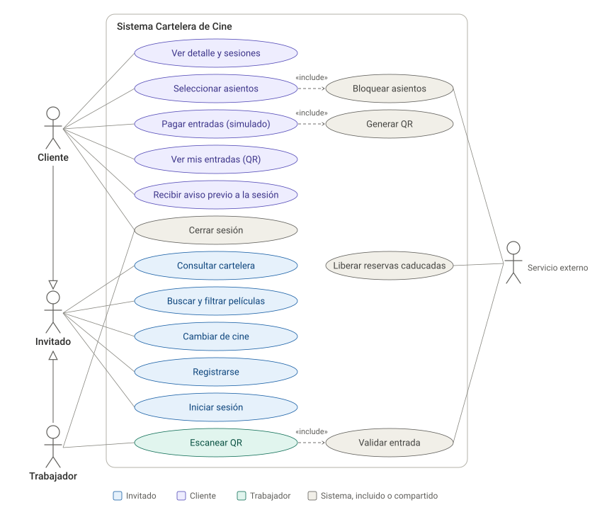

# Documentación

```
docs/
├── enunciado/      → enunciado oficial del trabajo final (PDF)
├── diagramas/      → diagramas: fuente editable + imagen SVG
└── memoria/        → memoria en LaTeX (memoria.tex) y figuras PNG que usa
```

## Memoria

[memoria/memoria.tex](memoria/memoria.tex) compila con pdfLaTeX (Overleaf o MiKTeX/TeX Live). Las figuras se cargan desde `memoria/figuras/`.

Para usarla en Overleaf, subid `memoria.tex` y la carpeta `figuras/` manteniendo la misma estructura.

## Diagramas

| Diagrama | Fuente editable | Imagen |
|---|---|---|
| Casos de uso (provisional) | [casos-de-uso.puml](diagramas/casos-de-uso.puml) (PlantUML) | [casos-de-uso.svg](diagramas/casos-de-uso.svg) |

### Casos de uso



## Cómo editar los diagramas

- **PlantUML (`.puml`)**: plugin *PlantUML Integration* de Android Studio, o pegar el contenido en <https://www.plantuml.com/plantuml>.
- **Mermaid (bloques en `.md`)**: GitHub los renderiza automáticamente; para editar con vista previa, <https://mermaid.live>.
- Cuando cambie un diagrama, actualizad también su imagen (SVG) y el PNG de `memoria/figuras/` para que el README y la memoria coincidan.
